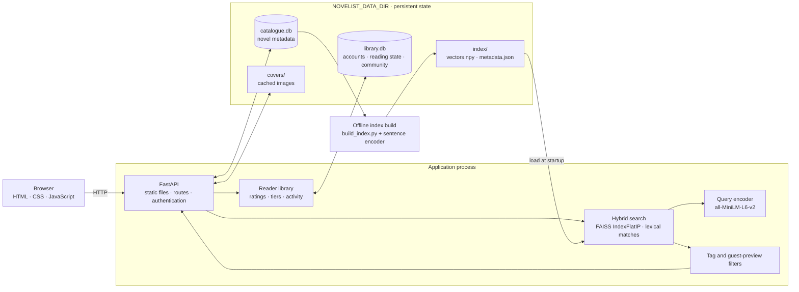
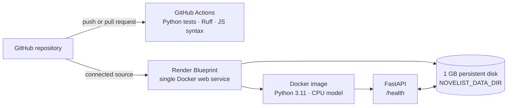

# NoveList architecture

NoveList runs as one FastAPI service that serves the browser client and the API. Catalogue search and personal library features share the service, while indexing is an explicit offline step.

## Search path

[`scripts/build_index.py`](../scripts/build_index.py) reads catalogue records, encodes their title, aliases, author, available description, and tags with `all-MiniLM-L6-v2`, and writes normalized vectors alongside a metadata snapshot. [`backend/search.py`](../backend/search.py) loads those files at startup into an in-memory FAISS `IndexFlatIP` and a lexical token map. At query time, the same model encodes the query; cosine similarity and exact or token matches contribute candidates. Tag and guest-preview filters are applied before results return. Startup checks that the snapshot matches the catalogue database.

Reader tier suggestions use ratings, confirmed tiers, tags, and reading status in [`backend/collection.py`](../backend/collection.py). They are calculated from the reader's saved state; they do not train a model or call an LLM.

## Configured delivery

## Deployment boundary

The root [`Dockerfile`](../Dockerfile) packages the API, client, and local sentence model. [`render.yaml`](../render.yaml) defines one Docker web service with `/health` checks and a disk mounted at `/app/backend/data`; [`backend/paths.py`](../backend/paths.py) places both SQLite databases, search artifacts, and cached covers under that mount. [GitHub Actions](../.github/workflows/ci.yml) runs tests and lint on pushes and pull requests. The [deployment guide](deployment.md) covers seeding, backup, and restore.

This topology is intentionally single-instance: search data is loaded in process, and the SQLite files and index artifacts belong to one mounted data directory. A move to Heroku Postgres or another managed database would require a storage migration and a new home for the search artifacts and cover cache; it is not part of the current deployment configuration.
